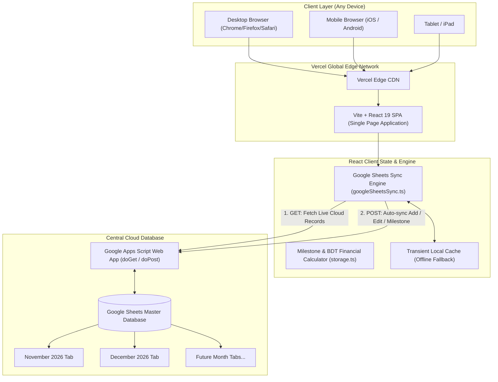
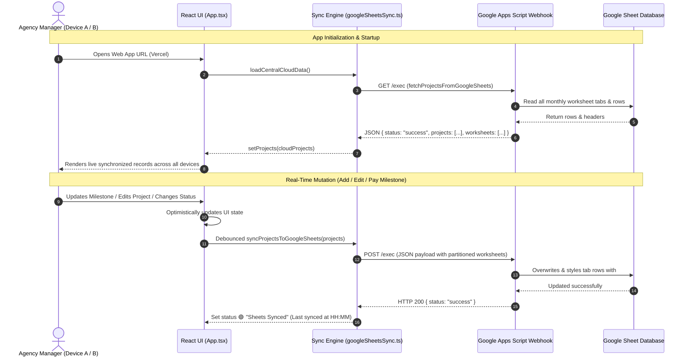
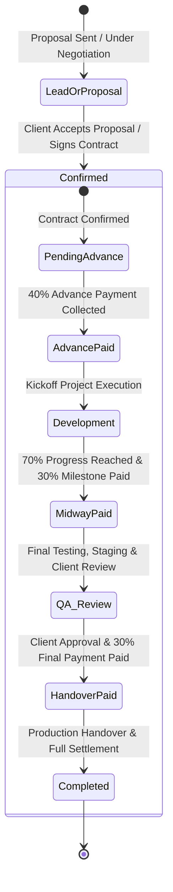

# ProjectFlow — Agency Client Management & Central Google Sheets Database

[](https://vercel.com/new)


-amber)


**ProjectFlow** is a modern, high-performance web application designed for digital agencies, software consultancies, and development studios. It provides end-to-end client project management, 40%-30%-30% milestone billing tracking in pure Bangladeshi Taka (BDT `৳`), and a **Google Sheets Central Cloud Database** architecture that guarantees 100% data consistency across all devices, browsers, and team members.

---

## 🌟 Key Features & Capabilities

- **Single Source of Truth (Google Sheets Database)**:
  - Eliminates device-isolated storage. All client records load directly from and persist to a centralized Google Sheet.
  - Changes made on a desktop immediately reflect on mobile browsers and across team members.
  - Transient offline cache fallback ensures fast initial paint even under intermittent connectivity.
- **Dynamic Milestone Financial Engine (40-30-30 & 50-50)**:
  - Intelligently splits project budgets into agency milestones based on service type:
    - **Standard Projects (Web App, SaaS, AI, Mobile)**:
      - **40% Advance Payment**: Collected upfront to kick off the project.
      - **30% Milestone Payment**: Billed upon 70% project completion.
      - **30% Final Payment**: Billed upon final handover and acceptance.
    - **Social Media Marketing**:
      - **50% Advance Payment**: Collected at month start / onboarding.
      - **50% Month-End Payment**: Billed upon month-end reporting and campaign completion.
  - Dynamically calculates Total Paid, Outstanding Due, and Collection Rate % in real-time.
- **Pure BDT (৳) Currency**:
  - Standardized on Bangladeshi Taka (`৳`) for accurate local accounting.
- **5 Core Agency Service Lines**:
  1. `web-app`: Web Applications (React, Next.js, Node.js)
  2. `ai-integration`: AI & LLM Systems (Gemini, RAG, Automation)
  3. `saas-product`: SaaS Products & Cloud Platforms
  4. `mobile-app`: Mobile Apps (iOS & Android)
  5. `social-media-marketing`: Social Media Marketing & Campaigns
- **Monthly & Yearly Worksheets Partitioning**:
  - Automatically isolates projects month-by-month (e.g., `November 2026`, `December 2026`, `2027 Full Year`).
  - Google Sheet database automatically mirrors these tabs with individual colored headers (`#93cf8c`).
  - Quick "+ New Month Sheet" button directly in the table header.
- **Spreadsheet-Style Table View with Sticky Columns**:
  - **Sticky Left**: `Company Name` stays pinned while horizontally scrolling.
  - **Sticky Right**: `Actions` (View, Edit, Delete) stays pinned.
  - Inline confirmation switcher (`Signed Contract` vs `Proposal Accepted`).
  - Interactive milestone check pills for instant payment toggling.
- **Multi-Format Export & Downloads**:
  - 📄 **UTF-8 CSV**: Ready for Excel, Google Drive, and database backups.
  - 📊 **Formatted Excel (.xls)**: Opens directly in Microsoft Excel with headers and colors.
  - 📋 **Clipboard TSV**: 1-click copy for pasting (`Ctrl+V`) directly into Google Sheets.
- **Executive Analytics & Telemetry**:
  - Filter by worksheet and date presets (Today, This Week, This Month, Past 6 Months, Past 1 Year, Custom Range).
  - Revenue Realization vs Due ratio progress bars.
  - Service portfolio distribution charts and project status breakdowns.
- **Hassle-Free Authentication**:
  - Instant Gmail access with automatically generated cross-device password.
  - One-click Demo Mode (`demo@projectflow.agency` / `demo123`).
  - Account Login for returning users on any browser.

---

## 🏗️ Architectural Diagrams

### 1. System Architecture Diagram



---

### 2. Real-Time Data Sync & Hydration Sequence



---

### 3. 40%-30%-30% Milestone Payment State Machine



---

## 💻 Tech Stack

| Layer | Technologies |
| :--- | :--- |
| **Frontend Framework** | [React 19](https://react.dev/), [TypeScript](https://www.typescriptlang.org/) |
| **Bundler & Tooling** | [Vite 8](https://vite.dev/), `@vitejs/plugin-react` |
| **Styling & Design System** | [Tailwind CSS v4](https://tailwindcss.com/), `@tailwindcss/vite` |
| **Icons & Micro-animations** | [Lucide React](https://lucide.dev/), [Motion](https://motion.dev/) |
| **Database & Cloud Storage** | [Google Sheets API](https://developers.google.com/sheets/api) via Google Apps Script Web App |
| **Deployment Platform** | [Vercel](https://vercel.com/) (Serverless & Edge CDN) |

---

## 📁 Project Directory Structure

```text
projectflow-project-management-tool/
├── .env                          # Local environment variables
├── .env.example                  # Environment template & configuration guide
├── vercel.json                   # Vercel deployment configuration & SPA rewrites
├── package.json                  # Dependencies & npm scripts
├── vite.config.ts                # Vite build configuration
├── index.html                    # HTML entry point with dark theme
└── src/
    ├── main.tsx                  # Application bootstrap & title injection
    ├── index.css                 # Global CSS & Tailwind CSS v4 directives
    ├── App.tsx                   # Core application state, cloud hydration & routing
    ├── config/
    │   └── appConfig.ts          # Central branding & application configuration
    ├── types/
    │   └── project.ts            # TypeScript interfaces (Project, Milestone, AuthUser, etc.)
    ├── utils/
    │   ├── storage.ts            # Financial calculators, export generators (CSV, Excel, TSV)
    │   └── googleSheetsSync.ts   # Google Sheets Webhook API engine & master Apps Script code
    └── components/
        ├── Navbar.tsx            # Clean top navigation with filter & profile popover
        ├── LoginScreen.tsx       # Gatekeeper: Gmail sign-in, Demo mode & Account login
        ├── ProjectTableView.tsx  # Sticky column table view with month switcher & export dropdown
        ├── FilterAnalyticsModal.tsx # Filter modal with live financial telemetry charts
        ├── ProfileSettingsModal.tsx # Profile popover with credentials & custom sheet tools
        ├── MetricsOverview.tsx   # Top KPI cards (Total Value, Advance, Revenue, Due)
        ├── ServiceTypeFilter.tsx # 5 service filters, search bar, sort & view mode switches
        ├── ProjectModal.tsx      # Add & Edit project modal with milestone calculation
        ├── ProjectDetailDrawer.tsx # Side drawer for comprehensive project telemetry
        ├── ProjectKanbanView.tsx # Kanban drag-and-drop / stage management view
        └── ProjectCardsView.tsx  # Grid card view of project portfolio
```

---

## ⚙️ Google Sheets Central Database Setup

Setting up your Google Sheets database takes under **3 minutes**:

### Step 1: Create a Google Sheet
1. Open [sheets.new](https://sheets.new) in your browser.
2. Title your spreadsheet (e.g., `Agency Client Records`).
3. Copy the **Spreadsheet ID** from the address bar:
   `https://docs.google.com/spreadsheets/d/`**`1BxiMVs0XRA5nFMdKvBdBZjgmUUqptlbs74OgvE2upms`**`/edit`
   *(The string between `/d/` and `/edit` is your `VITE_GOOGLE_SHEET_ID`)*.

### Step 2: Open Apps Script & Paste the Webhook Code
1. In your Google Sheet, click **Extensions > Apps Script**.
2. Delete any existing boilerplate in `Code.gs`.
3. Paste the following production code:

```javascript
/**
 * PROJECTFLOW GOOGLE SHEETS CENTRAL CLOUD DATABASE
 * Deploy as a Web App to enable live 2-way sync across all devices.
 */

function doGet(e) {
  try {
    var ss = SpreadsheetApp.getActiveSpreadsheet();
    var sheets = ss.getSheets();
    var allProjects = [];
    var worksheets = [];

    // Safe date formatter to avoid timezone day shifts
    function formatDateClean(val) {
      if (!val) return "";
      if (val instanceof Date) {
        if (isNaN(val.getTime())) return "";
        var year = val.getFullYear();
        var month = String(val.getMonth() + 1);
        if (month.length < 2) month = "0" + month;
        var day = String(val.getDate());
        if (day.length < 2) day = "0" + day;
        return year + "-" + month + "-" + day;
      }
      var str = String(val).trim();
      var match = str.match(/^(\d{4})-(\d{1,2})-(\d{1,2})/);
      if (match) {
        var m = match[2].length < 2 ? "0" + match[2] : match[2];
        var d = match[3].length < 2 ? "0" + match[3] : match[3];
        return match[1] + "-" + m + "-" + d;
      }
      var slashMatch = str.match(/^(\d{1,2})\/(\d{1,2})\/(\d{4})/);
      if (slashMatch) {
        var sd = slashMatch[1].length < 2 ? "0" + slashMatch[1] : slashMatch[1];
        var sm = slashMatch[2].length < 2 ? "0" + slashMatch[2] : slashMatch[2];
        return slashMatch[3] + "-" + sm + "-" + sd;
      }
      return str;
    }

    // Normalizes worksheet name to avoid Google Sheets Date object conversions
    function formatWorksheetClean(val, fallback) {
      var str = String(val || "").trim();
      if (!str) return fallback || "General";
      var months = ["January","February","March","April","May","June","July","August","September","October","November","December"];
      var strLower = str.toLowerCase();
      for (var mi = 0; mi < months.length; mi++) {
        var mName = months[mi].toLowerCase();
        var mShort = mName.substring(0, 3);
        if (strLower.indexOf(mName) !== -1 || strLower.indexOf(mShort) !== -1) {
          var yMatch = str.match(/\b(20\d\d)\b/);
          if (yMatch) {
            return months[mi] + " " + yMatch[1];
          }
        }
      }
      return fallback || str;
    }

    for (var s = 0; s < sheets.length; s++) {
      var sheet = sheets[s];
      var rawSheetName = sheet.getName();
      if (!rawSheetName || rawSheetName === "Template" || rawSheetName.indexOf("_") === 0) continue;
      var cleanSheetName = formatWorksheetClean(rawSheetName, rawSheetName);
      worksheets.push(cleanSheetName);

      var data = sheet.getDataRange().getValues();
      if (data.length <= 1) continue;

      var headerRow = data[0] || [];
      var colMap = {};
      for (var h = 0; h < headerRow.length; h++) {
        colMap[String(headerRow[h] || "").trim().toLowerCase()] = h;
      }

      var colCompany = colMap["company name"] !== undefined ? colMap["company name"] : 0;
      var colClient = colMap["clients name"] !== undefined ? colMap["clients name"] : 1;
      var colCompType = colMap["company type"] !== undefined ? colMap["company type"] : 2;
      var colProjType = colMap["project type"] !== undefined ? colMap["project type"] : 3;
      var colStart = colMap["start date"] !== undefined ? colMap["start date"] : 4;
      var colDeadline = colMap["target deadline"] !== undefined ? colMap["target deadline"] : 5;
      var colWs = colMap["worksheet"] !== undefined ? colMap["worksheet"] : 6;
      var colEst = colMap["budget estimated"] !== undefined ? colMap["budget estimated"] : 7;
      var colConf = colMap["budget confirmed"] !== undefined ? colMap["budget confirmed"] : 8;
      var colConfType = colMap["confirmation"] !== undefined ? colMap["confirmation"] : 9;
      var colAdv = colMap["40% / 50% advance"] !== undefined ? colMap["40% / 50% advance"] : 10;
      var colMid = colMap["30% (at 70%)"] !== undefined ? colMap["30% (at 70%)"] : 11;
      var colEnd = colMap["30% / 50% handover"] !== undefined ? colMap["30% / 50% handover"] : 12;
      var colPaid = colMap["total paid"] !== undefined ? colMap["total paid"] : 13;
      var colDue = colMap["due"] !== undefined ? colMap["due"] : 14;
      var colStatus = colMap["project status"] !== undefined ? colMap["project status"] : 15;
      var colProg = colMap["progress %"] !== undefined ? colMap["progress %"] : 16;
      
      var colDepPlatform = colMap["deployment platform"] !== undefined ? colMap["deployment platform"] : (colMap["deployment"] !== undefined ? colMap["deployment"] : 17);
      var colDepUrl = colMap["live deployment url"] !== undefined ? colMap["live deployment url"] : (colMap["deployment url"] !== undefined ? colMap["deployment url"] : (colMap["live url"] !== undefined ? colMap["live url"] : -1));

      var colPhone = colMap["client phone"] !== undefined ? colMap["client phone"] : (colDepUrl !== -1 ? 19 : 18);
      var colWhatsapp = colMap["whatsapp"] !== undefined ? colMap["whatsapp"] : (colDepUrl !== -1 ? 20 : 19);
      var colEmail = colMap["client email"] !== undefined ? colMap["client email"] : (colDepUrl !== -1 ? 21 : 20);
      var colNotes = colMap["notes"] !== undefined ? colMap["notes"] : (colDepUrl !== -1 ? 22 : 21);

      for (var r = 1; r < data.length; r++) {
        var row = data[r];
        if (!row[0] && !row[1]) continue;

        var companyName = String(row[colCompany] || "").trim();
        var clientsName = String(row[colClient] || "").trim();
        var companyType = String(row[colCompType] || "Enterprise Client").trim();
        var projectType = String(row[colProjType] || "web-app").toLowerCase().replace(/\s+/g, '-').trim();
        var startDate = formatDateClean(row[colStart]);
        var targetDeadline = formatDateClean(row[colDeadline]);
        var ws = formatWorksheetClean(row[colWs], cleanSheetName);
        var budgetEstimated = Number(row[colEst]) || 0;
        var budgetConfirmed = Number(row[colConf]) || 0;
        var confirmation = String(row[colConfType] || "Signed Contract").trim();

        var advRaw = String(row[colAdv] || "").toUpperCase();
        var midRaw = String(row[colMid] || "").toUpperCase();
        var endRaw = String(row[colEnd] || "").toUpperCase();

        var advancePaid = advRaw.indexOf("PAID") !== -1;
        var midwayPaid = midRaw.indexOf("PAID") !== -1;
        var handoverPaid = endRaw.indexOf("PAID") !== -1;

        var isSocial = projectType === "social-media-marketing";
        var advanceAmount = isSocial ? Math.round(budgetConfirmed * 0.5) : Math.round(budgetConfirmed * 0.4);
        var midwayAmount = isSocial ? 0 : Math.round(budgetConfirmed * 0.3);
        var handoverAmount = budgetConfirmed - advanceAmount - midwayAmount;

        var totalPaid = (advancePaid ? advanceAmount : 0) + (isSocial ? 0 : (midwayPaid ? midwayAmount : 0)) + (handoverPaid ? handoverAmount : 0);
        var dueAmount = Math.max(0, budgetConfirmed - totalPaid);

        var projectStatus = String(row[colStatus] || (totalPaid === budgetConfirmed && budgetConfirmed > 0 ? "Completed" : "In Progress")).trim();

        // Parse Progress % accurately
        var rawProg = row[colProg];
        var progressPercent = 0;
        if (rawProg !== "" && rawProg !== null && rawProg !== undefined) {
          var pNum = Number(String(rawProg).replace("%", "").trim());
          if (!isNaN(pNum)) {
            if (pNum > 0 && pNum <= 1 && String(rawProg).indexOf("%") === -1) {
              progressPercent = Math.round(pNum * 100);
            } else {
              progressPercent = Math.round(pNum);
            }
          }
        } else {
          progressPercent = projectStatus === "Completed" ? 100 : (projectStatus === "70% Done" ? 70 : 0);
        }

        // Parse Deployment Platform & Live URL accurately
        var deployment = "";
        var deploymentUrl = "";
        if (colDepUrl !== -1) {
          deployment = String(row[colDepPlatform] || "").trim();
          deploymentUrl = String(row[colDepUrl] || "").trim();
        } else {
          var rawDepVal = String(row[colDepPlatform] || "").trim();
          if (rawDepVal.indexOf("http://") === 0 || rawDepVal.indexOf("https://") === 0) {
            deploymentUrl = rawDepVal;
            deployment = "Live";
          } else {
            deployment = rawDepVal;
            deploymentUrl = "";
          }
        }

        var clientPhone = String(row[colPhone] || "").trim();
        var clientWhatsapp = String(row[colWhatsapp] || clientPhone).trim();
        var clientEmail = String(row[colEmail] || "").trim();
        var notes = String(row[colNotes] || "").trim();

        var id = "proj-" + cleanSheetName.toLowerCase().replace(/[^a-z0-9]/g, '-') + "-" + r;

        allProjects.push({
          id: id,
          companyName: companyName,
          clientsName: clientsName,
          companyType: companyType,
          projectType: projectType,
          budgetEstimated: budgetEstimated,
          budgetConfirmed: budgetConfirmed,
          confirmation: confirmation,
          confirmationDate: startDate || formatDateClean(new Date()),
          progressPercent: progressPercent,
          milestones: {
            advance40: {
              percent: isSocial ? 50 : 40,
              label: isSocial ? "50% Advance Payment" : "40% Advance Payment",
              amount: advanceAmount,
              paid: advancePaid
            },
            midway30: {
              percent: isSocial ? 0 : 30,
              label: isSocial ? "N/A (50-50 Model)" : "30% Milestone Payment",
              amount: midwayAmount,
              paid: isSocial ? false : midwayPaid
            },
            handover30: {
              percent: isSocial ? 50 : 30,
              label: isSocial ? "50% Month-End Payment" : "30% Final Handover",
              amount: handoverAmount,
              paid: handoverPaid
            },
            model: isSocial ? "50-50" : "40-30-30"
          },
          totalPaid: totalPaid,
          dueAmount: dueAmount,
          projectStatus: projectStatus,
          deployment: deployment,
          deploymentUrl: deploymentUrl,
          clientEmail: clientEmail,
          clientPhone: clientPhone,
          clientWhatsapp: clientWhatsapp,
          startDate: startDate,
          targetDeadline: targetDeadline,
          worksheet: ws,
          notes: notes,
          createdAt: startDate || formatDateClean(new Date()),
          updatedAt: formatDateClean(new Date())
        });
      }
    }

    return ContentService.createTextOutput(JSON.stringify({
      status: "success",
      projects: allProjects,
      worksheets: worksheets
    })).setMimeType(ContentService.MimeType.JSON);
  } catch (err) {
    return ContentService.createTextOutput(JSON.stringify({
      status: "error",
      message: err.toString()
    })).setMimeType(ContentService.MimeType.JSON);
  }
}

function doPost(e) {
  try {
    var contents = JSON.parse(e.postData.contents);
    var ss = SpreadsheetApp.getActiveSpreadsheet();
    var currency = contents.currency || "BDT";
    var action = contents.action || "sync";

    var headers = [
      "Company Name", "Clients Name", "Company Type", "Project Type",
      "Start Date", "Target Deadline", "Worksheet",
      "Budget Estimated (" + currency + ")", "Budget Confirmed (" + currency + ")",
      "Confirmation", "40% / 50% Advance", "30% (at 70%)", "30% / 50% Handover",
      "Total Paid (" + currency + ")", "Due (" + currency + ")",
      "Project Status", "Progress %", "Deployment Platform", "Live Deployment URL",
      "Client Phone", "WhatsApp", "Client Email", "Notes"
    ];

    // Handle explicit single worksheet deletion
    if (action === "deleteWorksheet" && contents.worksheetName) {
      var targetSheet = ss.getSheetByName(contents.worksheetName);
      if (targetSheet) {
        if (ss.getSheets().length > 1) {
          ss.deleteSheet(targetSheet);
        } else {
          targetSheet.clearContents();
          targetSheet.setName("General");
          targetSheet.appendRow(headers);
        }
        return ContentService.createTextOutput(JSON.stringify({
          status: "success",
          message: "Worksheet " + contents.worksheetName + " deleted successfully."
        })).setMimeType(ContentService.MimeType.JSON);
      }
      return ContentService.createTextOutput(JSON.stringify({
        status: "not_found",
        message: "Worksheet " + contents.worksheetName + " was not found."
      })).setMimeType(ContentService.MimeType.JSON);
    }

    // Handle full database reset
    if (action === "resetAll") {
      var sheets = ss.getSheets();
      var defaultSheet = sheets[0];
      defaultSheet.setName("General");
      defaultSheet.clearContents();
      defaultSheet.appendRow(headers);
      var headerRange = defaultSheet.getRange(1, 1, 1, headers.length);
      headerRange.setBackground("#93cf8c").setFontColor("#090d16").setFontWeight("bold");

      for (var d = sheets.length - 1; d > 0; d--) {
        ss.deleteSheet(sheets[d]);
      }

      return ContentService.createTextOutput(JSON.stringify({
        status: "success",
        message: "Database reset successfully."
      })).setMimeType(ContentService.MimeType.JSON);
    }

    // Standard sync action
    var projects = contents.projects || [];
    var activeWorksheets = contents.activeWorksheets || contents.worksheets || [];

    // Group projects by monthly worksheet
    var grouped = {};
    for (var i = 0; i < projects.length; i++) {
      var p = projects[i];
      var ws = p.worksheet || "General";
      if (!grouped[ws]) grouped[ws] = [];
      grouped[ws].push(p);
    }

    // Collect all valid target sheets
    var targetSheets = {};
    if (Array.isArray(activeWorksheets)) {
      for (var a = 0; a < activeWorksheets.length; a++) {
        var wName = String(activeWorksheets[a] || "").trim();
        if (wName && wName !== "All Worksheets") {
          targetSheets[wName] = true;
        }
      }
    }
    for (var g in grouped) {
      if (g && g !== "All Worksheets") {
        targetSheets[g] = true;
      }
    }

    // Remove any physical sheets in spreadsheet that are NOT in targetSheets (except Template/system)
    if (Object.keys(targetSheets).length > 0) {
      var existingSheets = ss.getSheets();
      for (var k = 0; k < existingSheets.length; k++) {
        var curSheet = existingSheets[k];
        var curName = curSheet.getName();
        if (!curName || curName === "Template" || curName.indexOf("_") === 0) continue;
        if (!targetSheets[curName]) {
          if (ss.getSheets().length > 1) {
            ss.deleteSheet(curSheet);
          } else {
            curSheet.clearContents();
          }
        }
      }
    }

    // Mirror each target sheet
    for (var sheetName in targetSheets) {
      var sheet = ss.getSheetByName(sheetName);
      if (!sheet) {
        sheet = ss.insertSheet(sheetName);
      }

      sheet.clearContents();
      sheet.appendRow(headers);

      var headerRange = sheet.getRange(1, 1, 1, headers.length);
      headerRange.setBackground("#93cf8c").setFontColor("#090d16").setFontWeight("bold");

      var items = grouped[sheetName] || [];
      for (var j = 0; j < items.length; j++) {
        var item = items[j];
        var isSocial = item.projectType === "social-media-marketing";
        var advStatus = item.advancePaid ? "PAID (৳" + Number(item.advance40 || 0).toLocaleString() + ")" : "DUE (৳" + Number(item.advance40 || 0).toLocaleString() + ")";
        var midStatus = isSocial ? "N/A (50-50)" : (item.midwayPaid ? "PAID (৳" + Number(item.midway30 || 0).toLocaleString() + ")" : "DUE (৳" + Number(item.midway30 || 0).toLocaleString() + ")");
        var endStatus = item.handoverPaid ? "PAID (৳" + Number(item.handover30 || 0).toLocaleString() + ")" : "DUE (৳" + Number(item.handover30 || 0).toLocaleString() + ")";

        sheet.appendRow([
          item.companyName,
          item.clientsName,
          item.companyType,
          item.projectType,
          item.startDate || "",
          item.targetDeadline || "",
          sheetName,
          item.budgetEstimated,
          item.budgetConfirmed,
          item.confirmation,
          advStatus,
          midStatus,
          endStatus,
          item.totalPaid,
          item.dueAmount,
          item.projectStatus,
          (item.progressPercent !== undefined ? item.progressPercent : 0) + "%",
          item.deployment || "",
          item.deploymentUrl || "",
          item.clientPhone || "",
          item.clientWhatsapp || "",
          item.clientEmail || "",
          item.notes || ""
        ]);
      }

      for (var c = 1; c <= headers.length; c++) {
        sheet.autoResizeColumn(c);
      }
    }

    return ContentService.createTextOutput(JSON.stringify({ status: "success", count: projects.length }))
      .setMimeType(ContentService.MimeType.JSON);
  } catch (err) {
    return ContentService.createTextOutput(JSON.stringify({ status: "error", message: err.toString() }))
      .setMimeType(ContentService.MimeType.JSON);
  }
}
```
4. Click **Save** (<kbd>Ctrl + S</kbd>).

### Step 3: Deploy as Web App
1. Click **Deploy > New deployment**.
2. Select type: **Web app** (via the ⚙️ gear icon).
3. Set fields:
   - **Execute as:** `Me (your-email@gmail.com)`
   - **Who has access:** `Anyone` *(Crucial so the client web app can read and write)*.
4. Click **Deploy**, authorize permissions, and copy the generated **Web app URL**:
   `https://script.google.com/macros/s/AKfycb.../exec`

### Step 4: Configure `.env`
Open `.env` in the project root and insert your values:

```env
VITE_GOOGLE_SHEETS_WEBHOOK_URL="https://script.google.com/macros/s/YOUR_DEPLOYED_WEBAPP_ID/exec"
VITE_GOOGLE_SHEET_ID="YOUR_SPREADSHEET_ID"
VITE_APP_URL="http://localhost:5173"
```

---

## 🚀 Local Development

### 1. Clone & Install
```bash
git clone https://github.com/your-username/projectflow.git
cd projectflow
npm install
```

### 2. Run Local Development Server
```bash
npm run dev
```
The app will run at `http://localhost:5173` (or configured port).

### 3. Type Checking & Production Build
```bash
# Check TypeScript types
npm run lint

# Build production bundle
npm run build
```

---

## 🌐 Vercel Deployment Guide

Deploying ProjectFlow to Vercel takes less than **2 minutes**:

### Method A: Deploy via Vercel Dashboard (Recommended)

1. Push your repository to **GitHub**, **GitLab**, or **Bitbucket**.
2. Go to [Vercel Dashboard](https://vercel.com/dashboard) and click **"Add New... > Project"**.
3. Import your ProjectFlow repository.
4. In the **Configure Project** screen:
   - **Framework Preset**: `Vite`
   - **Build Command**: `npm run build`
   - **Output Directory**: `dist`
5. Expand **Environment Variables** and add the following keys:
   - `VITE_GOOGLE_SHEETS_WEBHOOK_URL` = *(Your deployed Google Apps Script URL)*
   - `VITE_GOOGLE_SHEET_ID` = *(Your Google Spreadsheet ID)*
   - `VITE_APP_URL` = *(Your Vercel deployment URL, e.g. `https://projectflow.vercel.app`)*
6. Click **Deploy**.

### Method B: Deploy via Vercel CLI

```bash
# 1. Install Vercel CLI globally
npm i -g vercel

# 2. Login to your Vercel account
vercel login

# 3. Deploy to production with environment variables
vercel --prod
```

### Verification After Deployment:
- Open your production Vercel URL on your computer: add a project.
- Open the exact same Vercel URL on your phone or in an incognito window.
- Notice how all project records, status updates, and monthly tabs are **100% synchronized and identical** in real-time through your central Google Sheets database!

---

## 📄 License & Attribution

Distributed under the MIT License. Developed with React 19, Tailwind CSS v4, and Google Sheets Cloud Database Engine.
